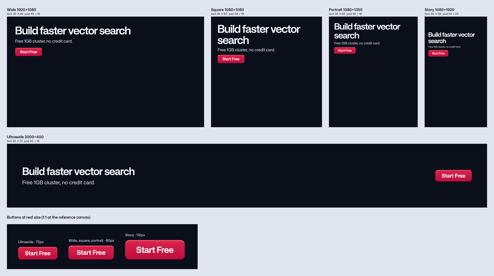

# Button

The call to action in a post ("Start Free", "Register", "Read more"). Written as rules, not fixed sizes: an agent reads them and builds the button for the creative it's making.

Based on the Qdrant Web Design button (Figma [Qdrant Web Design, node 793-2956](https://www.figma.com/design/ubPe8s8pViytom0Mapcno8/Qdrant-Web-Design?node-id=793-2956)). It's no longer interim: the Qdrant Brand Design System's Figma button (file `8y0svqBDPZX6caRNF6lddG`, node `13872:1092`) isn't used, and the buttons in the Figma files will be updated from this repo (Juan, 2026-11-18).

**The look comes from the design system** (since 2026-11-12): [`design-system/styles/components/button.css`](../../design-system/styles/components/button.css) holds the fill, the raised edge and shadow, the label color and weight, and the web states, as `--qd-ui-button-*` variables. The web Button in the design system reads the same file, so the two always match. This folder only sizes the button for the canvas. To change the look, change that file, never `button.css` here.

| File | What it is |
| --- | --- |
| `button.css` | `.qd-button`, sized per shape with the canvas scale. Imports the look from the design system, so pages only load this file |
| `sketch.png` | The button on every shape, plus the three sizes at real size |

## Sketch



## Use it for

The one call to action in an ad or post. Not for links in body copy.

## Kind

Part.

## Rules

1. **Main / Default only in creatives.** Static posts have no hover, focus or disabled state, and the Campaigns "Paid Ads" page uses only Main / Default (about 280 buttons). Secondary and the other states are documented below for web use only.
2. **Text size per shape**, in px at the reference canvas:

   | Shape | Reference | Text |
   | --- | --- | --- |
   | `ultrawide` | 3000×400 | 32px |
   | `wide` | 1920×1080 | 36px |
   | `square` | 1080×1080 | 36px |
   | `portrait` | 1080×1350 | 36px |
   | `story` | 1080×1920 | 48px |

   Button text is part of the button: it scales with the button's height and is not one of the creative's two text sizes ([`typography/`](../../primitives/typography/) "Text in creatives", decided 2026-11-04).

   36px matches the ads sub-copy rule (36–40px) in [`typography/`](../../primitives/typography/). Story is larger, in line with the 46–50px used on current story creatives.
3. **Everything else follows the text size**, in the same proportions as the Figma button, rounded to the 8px grid.
   - Height: 2.25 × text
   - Side padding: 1.25 × text
   - Radius: 0.5 × text
4. **Other canvas sizes scale** like the rest of [`layout/`](../../guidelines/layout/): by the smaller of width ÷ reference width and height ÷ reference height. Put the button inside a `.qd-canvas` and the CSS does this.
5. **SemiBold (600)**, the same weight as the Figma button and every heading style in `typography/`. Not Bold, even though most creatives on the Campaigns page used Bold.
6. **Placement:** last in the text block, aligned with the text, top-right level with the logo, or bottom-right on the bottom margin when the details run along the bottom-left. **Always in a corner (bottom-left, top-right or bottom-right), never mid-layout** (2026-11-16): top-right only when the text block spans the full width; when the text block is only part of the width (e.g. wide with a visual on the right), the button goes last in the text block ([`guidelines/`](../../guidelines/) section 11, rule 10, decided 2026-11-11). **Exception, the light card:** outside the card, centered below it, sized by the card (`.qd-book__cta`, see [`layout/`](../../guidelines/layout/) "Light card layout"). Never full width ([`guidelines/`](../../guidelines/) section 11, rule 10).
7. **Beside the logo, the same height as the logo.** Add `qd-button--beside-logo`: the height becomes the logo's height for the shape (72 or 80 px) and the text, padding and corners follow it in the same proportions. The button is never taller than the logo next to it (decided 2026-11-04).
8. **Never resized to make room** (Vanesa, 2026-11-16). When a creative is tight, tighten the gaps, shrink the headshots or cut copy ([`guidelines/`](../../guidelines/) section 11, rule 11). The button keeps its size for the shape.
9. **On a red pattern: top-right beside the logo,** on the dark part of the pattern, with **3:1 or more** against what's around it. This 3:1 rule is only for red patterns ([`guidelines/`](../../guidelines/) section 3, 2026-11-16).
10. **Never an icon.** The creative button is text only, Main and Secondary (decided 2026-11-11). Web and product buttons, from the design system, may have one ([`design-system/AGENTS.md`](../../design-system/AGENTS.md), 2026-11-18).
11. **One button per post.**

## Size and inner gaps

In px at the reference canvas:

| Shape | Height | Text | Side padding | Radius | Raised edge |
| --- | --- | --- | --- | --- | --- |
| `ultrawide` | 72 | 32 | 40 | 16 | 2 |
| `wide`, `square`, `portrait` | 80 | 36 | 48 | 16 | 2.2 |
| `story` | 112 | 48 | 64 | 24 | 3.1 |

## Colors

**Flat and raised since 2026-11-19 (Vanesa):** the creative button matches the web button (`design-system/components/ui/button.tsx`): one flat amaranth fill, no gradient and no inner highlight, on a raised surface (a faint 1 px edge, a top light and a short drop shadow). The edge and shadow are shares of the button's height (1/36 and 3/36, from the 36 px web button), so they scale with every canvas. It replaces the gradient and top highlight from the Qdrant Web Design button.

Set in [`design-system/styles/components/button.css`](../../design-system/styles/components/button.css), token names only. Figma colors that have no token use the nearest one. Moved to the Figma primitive names on 2026-11-12: the brand red is `amaranth-600`, the same `#DC244C` as before.

| Part | Token | Figma |
| --- | --- | --- |
| Fill (flat) | `amaranth-600` | Primary/P50 #DC244C |
| Raised edge and top light | `neutral-0` at 4 / 6 / 10% (dark), `neutral-1000` at 60% of that (light) | From the web button (Supabase-style) |
| Drop shadow | `neutral-1000` at 20% (dark), 4% (light) | From the web button |
| Text | `neutral-0` | Neutral/N100 #FFFFFF |

## How to use

```html
<link rel="stylesheet" href="primitives/colors/colors.css">
<link rel="stylesheet" href="primitives/typography/typography.css">
<link rel="stylesheet" href="guidelines/layout/layout.css">
<link rel="stylesheet" href="brand-components/button/button.css">

<div class="qd-canvas" data-shape="square" style="--qd-canvas-width: 1080; --qd-canvas-height: 1080">
  …
  <span class="qd-button">Start Free</span>
</div>
```

## Web states (reference, not for creatives)

The design system's Button uses these states from the shared look file (hover, focus, disabled for Main). Secondary isn't used: the design system's outline button has its own look, with the shared focus ring ([`DESIGN.md`](../../design-system/DESIGN.md), Outline button, 2026-11-18).

From the Figma button, at web size (XS / MD / LG = 36 / 40 / 48px tall, SemiBold 16 / 16 / 18px, side padding 20 / 22 / 28px, radius 8px). Colors mapped to the nearest tokens. The design system's web button keeps 14px text at every size instead, like its fields ([`DESIGN.md`](../../design-system/DESIGN.md), Button text, 2026-11-18).

| Type / State | Fill | Border | Text |
| --- | --- | --- | --- |
| Main / Hover | `amaranth-600`, highlight `amaranth-400` | none | white |
| Main / Focused | `amaranth-600` | 2px ring, `amaranth-600` at 40% | white |
| Main / Disabled | `amaranth-400` | none | white |
| Secondary / Default | none | 1px `neutral-600` | white |
| Secondary / Hover | none | 2px `neutral-400` | white |
| Secondary / Focused | none | 2px `neutral-50` | white |
| Secondary / Disabled | none | 1px `neutral-700` | white at 20% |

## Still open

- **Over patterns or images:** does it need anything extra to stand out?

## Approved by / date

Vanesa, 2026-11-04.
