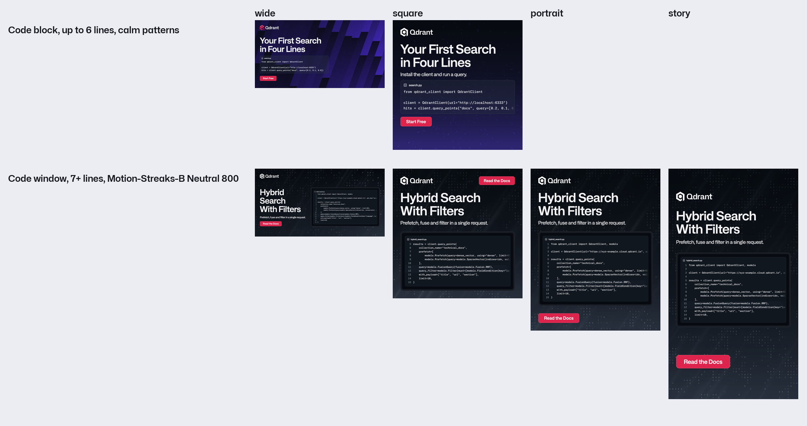

# Code block

Code in a creative: an install command, a query, a snippet from the docs. It's the design system's CodeBlock ([`design-system/components/ui/code-block.tsx`](../../design-system/components/ui/code-block.tsx)), drawn exactly as in the UI, with a few rules on top for creatives (Vanesa, 2026-11-25).

It's the one web component creatives use as it is. The others (Badge, Card, Avatar) stay out ([`brand-components/`](../)).

| File | What it is |
| --- | --- |
| `code-block.css` | `.qd-code-block` and `.qd-code-window`, sized with the canvas scale. Same values as the UI component; the file lists where each color comes from |
| `sketch.png` | Short code on a calm pattern, and long code in a code window on every shape |

## Sketch

## Use it for

Developer content: a quickstart, a new API, a migration, a feature shown in code. Only real code the person gives you or that's in the docs: never write code for a creative (`AGENTS.md`, "Never").

## Kind

Part.

## Two forms

| Form | When | Looks | Where |
| --- | --- | --- | --- |
| **Code block** (`.qd-code-block`) | Short code, **up to 6 lines** | Exactly the UI: 30% fill, so the pattern shows through softly | Only on **calm patterns** (below), where the text sits |
| **Code window** (`.qd-code-window`) | **7 lines or more** | The code block inside a solid framed window, a product screen ([`guidelines/`](../../guidelines/) section 7). Nothing behind it shows through | On **any approved pattern** |

### Code block: only on calm patterns

The see-through block goes only on patterns with no letters and no rows of lines, which would read like more code behind the code (Vanesa, 2026-11-25):

- **Yes:** Generative-Burst-Pattern, Generative-Rings-Pattern, Generative-Hexagon-Pattern, Motion-Streaks-Pattern-A, Color-Sliced-Pattern-A.
- **Never:** Generative-Dash-Pattern, Color-Sliced-Pattern-B, Motion-Streaks-Pattern-B. On these, use the code window, even for short code.

It sits where the text sits: in the text column, on the masked side of a masked pattern. Never on the pattern's full-strength part.

### Code window: hugs the code

- **The frame hugs the code block:** no empty space inside, no bleed off the canvas, inside the margins (Vanesa, 2026-11-25).
- **Suggest:** Motion-Streaks-Pattern-B in Neutral 800, no mask, is the preferred look (Vanesa, 2026-11-25).
- Dark only for now. A light window hasn't been tried.

Layout per shape:

| Shape | Layout |
| --- | --- |
| Wide (LinkedIn post) | Text block on columns 1–5 (logo, title, supporting, button), the window on columns 6–12, both centered top to bottom |
| Square | Text at full width; the button top-right beside the logo; the window below, ending at the bottom margin |
| Portrait and story | Text at the top, the window below it, the button in the bottom-left corner. On story the window stays out of the bottom safe zone |

## Rules

1. **The look is the UI component's, never redrawn by hand.** Fill, border, radius, padding, font and line height come from `code-block.tsx` through `code-block.css`. The whole block scales as one piece: 2× the UI's px at the reference canvas for the code block, 1.4× inside a code window (it reads as a screenshot of the UI).
2. **Long code is cut down, never squeezed.** If it doesn't fit, show only the lines that matter, with their real line numbers (`data-n`), and mark the key lines with the highlight (`.qd-code-block__line--highlighted`). On square, a 15-line snippet shows the query only (lines 5–15).
3. **Long lines are cut, never wrapped.** The line fades out at the block's right edge, as the UI does before it scrolls. Wrapped code loses its indentation and pushes the layout past the margins.
4. **Line numbers** are optional in a code block and the default in a code window. Added and removed lines (`--added`, `--removed`) for migrations and diffs.
5. **The file name header** (`.qd-code-block__header`) is optional: use it when the snippet is a file.
6. **One code block or window per creative**, and it's the visual: never with Qbot, headshots or another product screen ([`guidelines/`](../../guidelines/) section 5).
7. **Text sizes:** the code, line numbers and file name keep the component's own sizes. They don't count toward the two text sizes, like the headshot parts (`primitives/typography/`), and Mona Sans Mono is allowed for code at any length.

## Checks

`review/measure.js` marks text inside `.qd-code-block` as code, and `review/check.py`:

- checks the block or window against the margins and the grid, not each line (a cut line runs on past the fade);
- leaves code out of the two-sizes, supporting-size and Mona Sans Mono checks;
- still checks the code's contrast, against what's behind the visible part of each line.

## Approved by

Vanesa, 2026-11-25 (draft).
