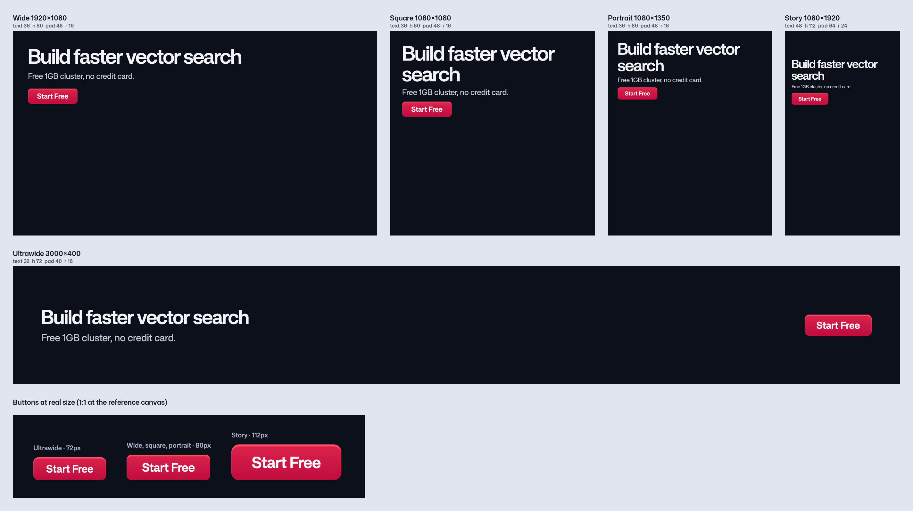

# Button

The call to action in a post ("Start Free", "Register", "Read more"). Written as rules, not fixed sizes: an agent reads them and builds the button for the creative it's making.

**Interim.** Based on the Qdrant Web Design button that the current system still uses (Figma [Qdrant Web Design, node 793-2956](https://www.figma.com/design/ubPe8s8pViytom0Mapcno8/Qdrant-Web-Design?node-id=793-2956)). The Qdrant Brand Design System button (file `8y0svqBDPZX6caRNF6lddG`, node `13872:1092`) replaces it later.

| File | What it is |
| --- | --- |
| `button.css` | `.qd-button`, sized per shape. Uses only `--qd-` tokens and the canvas scale |
| `sketch.png` | The button on every shape, plus the three sizes at real size |

## Sketch



## Use it for

The one call to action in an ad or post. Not for links in body copy.

## Kind

Part.

## Rules

1. **Main / Default only in creatives.** Static posts have no hover, focus or disabled state, and the Campaigns "Paid Ads" page uses only Main / Default (about 280 buttons). Secondary and the other states are documented below for web use only.
2. **Text size per shape**, in px at the reference canvas:

   | Shape | Reference | Text |
   | --- | --- | --- |
   | `ultrawide` | 3000×400 | 32px |
   | `wide` | 1920×1080 | 36px |
   | `square` | 1080×1080 | 36px |
   | `portrait` | 1080×1350 | 36px |
   | `story` | 1080×1920 | 48px |

   36px matches the ads sub-copy rule (36–40px) in [`typography/`](../../primitives/typography/). Story is larger, in line with the 46–50px used on current story creatives.
3. **Everything else follows the text size**, in the same proportions as the Figma button, rounded to the 8px grid.
   - Height: 2.25 × text
   - Side padding: 1.25 × text
   - Radius: 0.5 × text
4. **Other canvas sizes scale** like the rest of [`layout/`](../../primitives/layout/): by the smaller of width ÷ reference width and height ÷ reference height. Put the button inside a `.qd-canvas` and the CSS does this.
5. **SemiBold (600)**, the same weight as the Figma button and every heading style in `typography/`. Not Bold, even though most creatives on the Campaigns page used Bold.
6. **One button per post.**

## Size and inner gaps

In px at the reference canvas:

| Shape | Height | Text | Side padding | Radius | Inner highlight |
| --- | --- | --- | --- | --- | --- |
| `ultrawide` | 72 | 32 | 40 | 16 | 4 |
| `wide`, `square`, `portrait` | 80 | 36 | 48 | 16 | 4.5 |
| `story` | 112 | 48 | 64 | 24 | 6 |

## Colors

Token names only. Figma colors that have no token use the nearest one.

| Part | Token | Figma |
| --- | --- | --- |
| Fill, top | `primary-500` | Primary/P50 #DC244C |
| Fill, bottom | `primary-700` | #BE003A (nearest token) |
| Inner highlight (top edge) | `primary-400` | #FF516B |
| Text | `neutral-white` | Neutral/N100 #FFFFFF |

## How to use

```html
<link rel="stylesheet" href="primitives/colors/colors.css">
<link rel="stylesheet" href="primitives/typography/typography.css">
<link rel="stylesheet" href="primitives/layout/layout.css">
<link rel="stylesheet" href="components/button/button.css">

<div class="qd-canvas" data-shape="square" style="--qd-canvas-width: 1080; --qd-canvas-height: 1080">
  …
  <span class="qd-button">Start Free</span>
</div>
```

## Web states (reference, not for creatives)

From the Figma button, at web size (XS / MD / LG = 36 / 40 / 48px tall, SemiBold 16 / 16 / 18px, side padding 20 / 22 / 28px, radius 8px). Colors mapped to the nearest tokens.

| Type / State | Fill | Border | Text |
| --- | --- | --- | --- |
| Main / Hover | `primary-500`, highlight `primary-300` | none | white |
| Main / Focused | `primary-500` | 2px ring, `primary-500` at 40% | white |
| Main / Disabled | `primary-300` | none | white |
| Secondary / Default | none | 1px `neutral-600` | white |
| Secondary / Hover | none | 2px `neutral-400` | white |
| Secondary / Focused | none | 2px `neutral-50` | white |
| Secondary / Disabled | none | 1px `neutral-700` | white at 20% |

Secondary has an optional leading icon (GitHub logo, 18 / 20 / 22px, gap 8 / 10 / 12px).

## Still open

- **Icons:** allowed in creatives? Which, leading or trailing?
- **Placement:** where the button goes in a post (last in the text block, aligned left, on the grid, ever full width).
- **Over patterns or images:** does it need anything extra to stand out?

## Approved by / date

Not approved yet.
