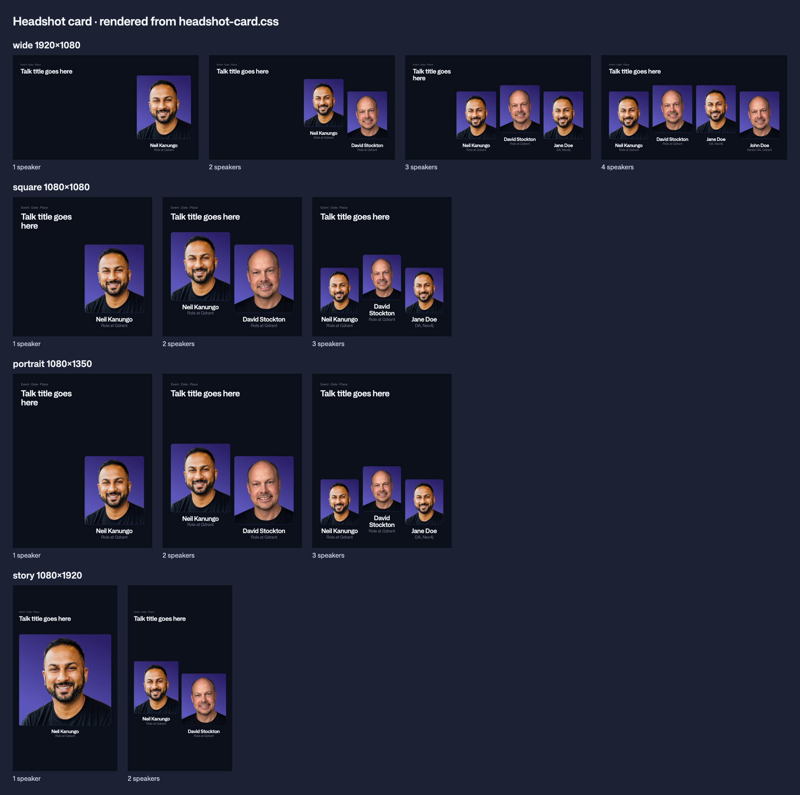

# Headshot card

The big headshot: a speaker's cutout on the headshot gradient in a tall card with rounded corners, with name and role centered below. For speakers who are the point of the post. For a small, quieter headshot use [`headshot-circle`](../headshot-circle/).

From Figma Brand-Collateral (`JQqxFCf33xbYJiOlHhtOjg`): [2 speakers](https://www.figma.com/design/JQqxFCf33xbYJiOlHhtOjg/Brand-Collateral?node-id=2183-29298), [3 speakers](https://www.figma.com/design/JQqxFCf33xbYJiOlHhtOjg/Brand-Collateral?node-id=2183-17250), [4 speakers](https://www.figma.com/design/JQqxFCf33xbYJiOlHhtOjg/Brand-Collateral?node-id=2183-32097). Sizes follow this repo's [layout grid](../../primitives/layout/), not the 8-column grid in those frames.

| File | What it is |
| --- | --- |
| `headshot-card.css` | `.qd-headshot-row` and `.qd-headshot-card`. Uses only `--qd-` tokens and the canvas scale |
| `sketch.png` | 1 to 4 speakers on wide, square, portrait and story, rendered from the CSS |

## Sketch



## Use it for

- Vector Space Talks (LinkedIn and YouTube)
- YouTube thumbnails with a featured person
- Speaker announcements

## Kind

Part.

## Shapes and spans

Each card spans whole columns of the shape's grid. Every card in a row has the same span. The gap between cards is the gutter.

| Shape | 1 speaker | 2 speakers | 3 speakers | 4 speakers |
| --- | --- | --- | --- | --- |
| `wide` 1920×1080 (12 cols) | span 4, right | span 3 each, right | span 3 each, right | span 3 each, full width |
| `square` 1080×1080 (6 cols) | span 3, right | span 3 each | span 2 each | use `headshot-circle` |
| `portrait` 1080×1350 (6 cols) | span 3, right | span 3 each | span 2 each | use `headshot-circle` |
| `story` 1080×1920 (4 cols) | span 4 | span 2 each | use `headshot-circle` | use `headshot-circle` |
| `ultrawide` 3000×400 | use `headshot-circle` | | | |

"Right" means the cards take the last columns and the title sits in the columns to their left. Otherwise the title sits above the row.

More than 4 speakers: use `headshot-circle`.

## Size and inner gaps

In px at the reference canvas. Every value scales with the canvas (see [`layout/`](../../primitives/layout/)).

| Part | Value |
| --- | --- |
| Card corners | 16 (`radius.lg`) |
| Card fill | `gradient.headshot` |
| Photo to name | the shape's `group` gap |
| Head to card top | the shape's `group` gap |
| Name | H3 SemiBold, 48, line height 1.1, `text.primary`, centered |
| Role | H5 Regular, 32, line height 1.3, `text.secondary`, centered |
| Photo shape | Portrait **5:7** (width : height), always. From the Vector Space Day banner (392×544, Brand-Collateral `2183:41590`) |
| Stagger (optional) | 2 speakers: 2 × `section` gap, the first card raised. 3 and 4: 1 × `section` gap, the middle card(s) raised. Off by default: add `qd-headshot-row--stagger` |

## The photo

1. **The card is always portrait 5:7.** It never stretches or squashes to fit the space (decided 2026-11-04, after the test made short, wide cards).
2. **The photo fills the card.** The cutout scales so the top of the head is one `group` gap below the card's top edge, anchored to the bottom and centered. The shoulders run off the sides, as in the Vector Space Day banner.
3. **Speakers sit on the bottom margin.** The cards line up at the bottom of the row. The space above them belongs to the visual area between the top and bottom blocks ([`guidelines/`](../../guidelines/) section 11, rule 7).
4. **No room: smaller span, then circles.** If 5:7 cards at the span in the table don't fit the height left, drop every card to the next smaller span (e.g. 3 → 2 on square). If they still don't fit, use [`headshot-circle`](../headshot-circle/). Never squash the card's shape.

## Rules

- **Always a photo.** Every speaker has one. If a photo is missing, stop and ask for it. Never use initials, a silhouette or text only in its place.
- **Prepared cutouts only.** Every photo is a cutout that passes [`brand-assets/imagery/headshots/`](../../brand-assets/imagery/headshots/): the slide 56 checklist and `check-headshot.py`.
- **Background:** plain `background.default`, or a brand pattern from [`patterns/`](../../brand-assets/patterns/). Never a generated image.
- **Never with Qbot.** Headshots and the mascot don't appear in the same creative.
- **Same treatment for everyone** in a post: same span, same gradient.

## How to use

```html
<link rel="stylesheet" href="primitives/colors/colors.css">
<link rel="stylesheet" href="primitives/typography/typography.css">
<link rel="stylesheet" href="primitives/layout/layout.css">
<link rel="stylesheet" href="components/headshot-card/headshot-card.css">

<div class="qd-canvas" data-shape="square" style="--qd-canvas-width: 1080; --qd-canvas-height: 1080">
  <h1>…</h1>
  <div class="qd-headshot-row qd-headshot-row--2">
    <div class="qd-headshot-card" style="--qd-span: 3">
      <div class="qd-headshot-card__photo"></div>
      <div class="qd-headshot-card__text">
        <p class="qd-headshot-card__name">Jane Doe</p>
        <p class="qd-headshot-card__role">DA, Neo4j</p>
      </div>
    </div>
    <!-- second card -->
  </div>
</div>
```

- Add `qd-headshot-row--2`, `--3` or `--4` for the count, and `qd-headshot-row--stagger` if you want the optional stagger.
- For a title beside the cards (1 to 3 speakers on wide, 1 on square and portrait), give the cards `--qd-start` and put the title in the same row with `grid-row: 1` and the columns to the left.
- The CSS reserves one line for the name and one for the role. Long names that wrap push the card up a little.

## Still open

- YouTube thumbnail (1280×720) is treated as `wide`. Check it once there's a real thumbnail.

## Approved by / date

Vanesa, 2026-11-04.
