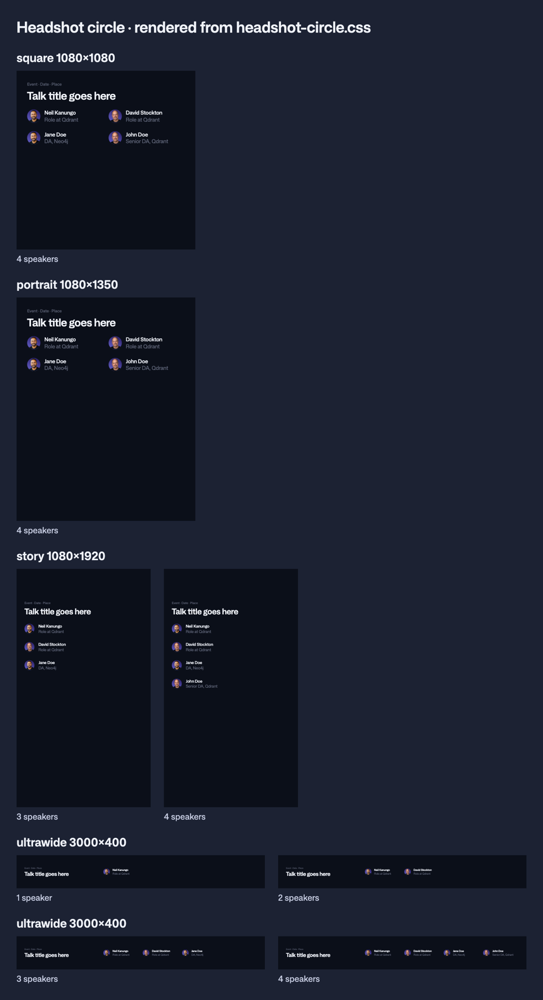

# Headshot circle

The small headshot: a speaker's cutout in an 80px circle on the headshot gradient, with name and role beside it. For when there isn't room for a [`headshot-card`](../headshot-card/), or the speaker shouldn't be featured and the post should stay subtle.

From Figma Brand-Collateral (`JQqxFCf33xbYJiOlHhtOjg`): [Agenda slot](https://www.figma.com/design/JQqxFCf33xbYJiOlHhtOjg/Brand-Collateral?node-id=2183-34418).

| File | What it is |
| --- | --- |
| `headshot-circle.css` | `.qd-headshot-circle`. Uses only `--qd-` tokens and the canvas scale |
| `sketch.png` | Circles on square, portrait, story and ultrawide, rendered from the CSS |

## Sketch



## Use it for

- Posts where a big card doesn't fit (see below)
- Speakers who shouldn't be the focus of the post
- Webinar and meetup banners
- Quote posts, to show who said it
- Inside a card (`.qd-box--card`), like the agenda slot
- Inside the light card (book), when a guide or doc creative needs a speaker ([`guidelines/`](../../guidelines/) section 4)

## Kind

Part.

## When it replaces the card

| Shape | Circles from |
| --- | --- |
| `ultrawide` 3000×400 | 1 speaker (always) |
| `story` 1080×1920 | 3 speakers |
| `square`, `portrait` | 4 speakers |
| `wide` 1920×1080 | 5 speakers |

On any shape it can also be chosen on purpose, for a quieter post.

## Size and inner gaps

In px at the reference canvas. Every value scales with the canvas (see [`layout/`](../../primitives/layout/)).

| Part | Value |
| --- | --- |
| Circle | 80 × 80, `gradient.headshot` behind the cutout |
| Circle to text | the shape's `group` gap |
| Name | H5 Medium, 32, line height 1.3, `text.primary` |
| Role | H5 Regular, 32, line height 1.3, `text.secondary` |

## Placing several

Use `.qd-grid`. Rows are a `section` gap apart.

| Shape | Per row | Span each |
| --- | --- | --- |
| `square`, `portrait` | 2 | 3 of 6 |
| `story` | 1 | 4 of 4 |
| `ultrawide` | up to 4, after the title (span 4) | 2 of 12 |
| `wide` | up to 4 | 3 of 12 |

## Rules

- **Always a photo.** Every speaker has one. If a photo is missing, stop and ask for it. Never use initials, a silhouette or text only in its place.
- **Prepared cutouts only.** Every photo is a cutout that passes [`brand-assets/imagery/headshots/`](../../brand-assets/imagery/headshots/): the slide 56 checklist and `check-headshot.py`.
- **Background:** plain `background.default`, a `.qd-box--card`, the light card (book), or a brand pattern from [`patterns/`](../../brand-assets/patterns/). Never a generated image. On Color-Sliced (red or violet), use Color-Sliced-Pattern-A, without the letters, so they don't compete with the faces ([`guidelines/`](../../guidelines/) section 2).
- **Role color on a pattern:** add `qd-on-pattern` to the canvas or row. Roles then use `neutral-300` instead of `text.secondary`, which fails contrast on violet patterns (decided 2026-11-04).
- **Never with Qbot.** Headshots and the mascot don't appear in the same creative.
- **Don't mix** circles and cards for speakers in the same post.

## How to use

```html
<link rel="stylesheet" href="primitives/colors/colors.css">
<link rel="stylesheet" href="primitives/typography/typography.css">
<link rel="stylesheet" href="primitives/layout/layout.css">
<link rel="stylesheet" href="components/headshot-circle/headshot-circle.css">

<div class="qd-canvas" data-shape="square" style="--qd-canvas-width: 1080; --qd-canvas-height: 1080">
  <h1>…</h1>
  <div class="qd-grid">
    <div class="qd-headshot-circle" style="--qd-span: 3">
      <div class="qd-headshot-circle__photo"></div>
      <div class="qd-headshot-circle__text">
        <p class="qd-headshot-circle__name">Jane Doe</p>
        <p class="qd-headshot-circle__role">DA, Neo4j</p>
      </div>
    </div>
    <!-- more speakers -->
  </div>
</div>
```

## Still open

- On ultrawide (3000×400) the 80px circle reads small. It may need its own size.

## Approved by / date

Vanesa, 2026-11-04.
