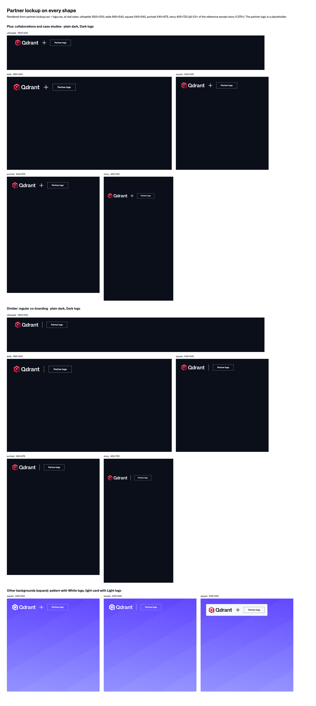

# Partner lockup

The Qdrant logo next to a partner's logo, with a plus or a divider between them. It takes the Qdrant logo's place: same spot, same size, same placement rules ([`brand-assets/logo/`](../../brand-assets/logo/)).

From Brand Guide 2.0, slides 20 and 21 (Figma [`djCexPSttVyDjQXDo9Rka4`](https://www.figma.com/design/djCexPSttVyDjQXDo9Rka4?node-id=1-8532)).

| File | What it is |
| --- | --- |
| `partner-lockup.css` | `.qd-partner-lockup`, `__plus` and `__divider`. Sized from the logo height, so it scales with the canvas |
| `sketch.png` | Plus and divider on every shape, plus a pattern and the light card, rendered from the CSS |

## Sketch



## Use it for

- **Plus:** a real collaboration, integrations, case studies.
- **Divider:** regular co-branding: events, sponsors, joint webinars.
- When it isn't clear which one fits, the agent decides and says which it picked.

## Kind

Part.

## Size and inner gaps

All as a share of the logo height `h` (the shape's logo size from `logo.css`: 72 px on ultrawide, square and portrait, 80 px on wide and story, at the reference canvas). Measured on Brand Guide slide 20.

| Piece | Size | At an 80 px logo |
| --- | --- | --- |
| Qdrant logo | `h` tall | 300 × 80 |
| Partner logo | `h` tall, same as Qdrant, width from its file | 80 tall |
| Gap each side of the separator | 2 cube widths, 0.65 `h` | 52 |
| Plus | 0.6 `h` square, stroke 0.07 `h` | 48, stroke about 6 |
| Divider | `h` tall, 0.03 `h` wide (at least 1 px) | 80 tall, about 2 wide |

The plus and divider take the text color: white on dark and on patterns, dark on the light card.

## Rules

- **Placement:** replaces the top-left Qdrant logo. Moves by the same Brand Guide rules when it has to.
- **Full Qdrant logo** only, never the brandmark alone.
- **Same height** for both logos, aligned top and bottom and optically balanced. Never stretch, compress or recolor either one. A partner wordmark with descenders sits on the Qdrant baseline.
- **Matching treatments:** both full color, or both one color. If the partner has no one-color version, the Qdrant logo is full color too, so the lockup goes on a plain dark background, a dark image or the light card, not on a pattern.
- **No added colors**, no random spacing, no very different sizes.
- **Not over a busy image.** Pick a calm area, or move it.
- **Clear space** around the whole lockup is the Qdrant logo's: 0.375 `h`.
- **Partner logo file:** the person supplies it (SVG, or a high-res PNG), with its one-color version if there is one. The agent asks for it.
- **Approval:** co-branded creatives are approved by both brand teams.

## Use

```html
<link rel="stylesheet" href="primitives/layout/layout.css">
<link rel="stylesheet" href="brand-assets/logo/logo.css">
<link rel="stylesheet" href="components/partner-lockup/partner-lockup.css">

<div class="qd-canvas" data-shape="square" style="--qd-canvas-width: 1080; --qd-canvas-height: 1080">
  <div class="qd-partner-lockup">
    
    <span class="qd-partner-lockup__plus"></span> <!-- or qd-partner-lockup__divider -->
    
  </div>
  …
</div>
```

## Approved by / date

Vanesa, 2026-11-04.
